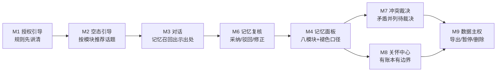

# 《念念》产品方案

> 阶段二产出 · 上游输入：[01-竞品拆解报告](01-竞品拆解报告.md) §4 映射总表 · 下游：[03-PRD](03-PRD.md)
> 产品形态：可点击 HTML 原型（[04-原型/index.html](04-原型/index.html)）

---

## 1. 定位一句话

> **豆包式"有记忆的 AI 助理"形态 × 我方"可验证信任"内核（证据链/复核流/口径纪律/分层记忆架构）= 念念——一个记忆看得见、查得到、管得住的 AI 陪伴助理。**

Slogan：**"记得你，也让你放心。"**

目标用户：使用 AI 陪伴/助理产品、但被"它忘了""它记错了""它偷偷记住让我发毛"困扰过的 C 端用户（对应用户调研中抱怨最集中的三类，见拆解报告 W1/W2/W5）。

---

## 2. 三层策略

| 层 | 定义 | 本案例落点 |
|---|---|---|
| **L1 复刻对齐** | 竞品验证过的需求面，体验不输，迁移无缺失感 | 多轮对话、自动+指令记忆、记忆管理面板、空态提示引导、重说/评价、温暖语气 |
| **L2 内核注入** | 同一功能多一层可验证的信任（证据可点/口径角标/复核流至少其一） | ①每条记忆带**来源引用卡** ②自动记忆先进**待确认队列** ③置信度+新鲜度**口径角标** ④引用历史对话时**出示出处** ⑤数据主权（导出/暂停） |
| **L3 独有差异化** | 竞品没有、短期难抄（依赖机制积累） | ①**记忆褪色机制**（时间衰减可视化，"30天未确认→AI 可能记不准"） ②**冲突检测卡**（新旧记忆矛盾→并列待裁决） ③**关怀账本+边界**（AI 主动关怀全部可回查依据、可限频、可单主题关停） |

> 判定纪律：记忆对话本体（L1）不硬贴标签；只有真正吃进内核的模块才标 L2；L3 必须写出"为什么抄不走"。

## 3. 板块 → 页面映射总表

（决策依据见拆解报告 §4；页面文件见 04-原型/）

| # | 模块 | 原型页 | 层级 | 一句话 |
|---|---|---|---|---|
| M1 | 记忆授权引导 | `onboarding.html` | L2 | 先讲清规则（记什么/怎么用/可撤）再开启，授权即合规 |
| M2 | 空态+提示词引导 | `chat-empty.html` | L1+ | 空态不空编：按记忆模块推荐话题，缺数据=原因+指引 |
| M3 | 对话进行时 | `chat.html` | L2 | 记忆召回有出处、生成有过程、不确定有诚实降级 |
| M4 | 记忆面板 | `memory.html` | L2→L3 | 八模块分组+口径角标，褪色可见 |
| M5 | 记忆详情 | `memory-detail.html` | L2 | 来源对话回查+修正历史账本 |
| M6 | 记忆复核 | `memory-review.html` | L2 | 待确认队列：采纳/驳回/修正 |
| M7 | 冲突裁决 | `conflict.html` | L3 | 新旧说法矛盾，并列呈现由用户裁决 |
| M8 | 关怀中心 | `care.html` | L3 | 计划+账本+边界三件套 |
| M9 | 我的/数据主权 | `profile.html` | L2 | 导出/暂停/删除，与产品主张自洽 |
| — | 案例封面 | `index.html` | — | 叙事入口：拆解→策略→PRD→原型导览 |

## 4. 信息架构

### 4.1 导航（PC 侧栏 ≥1024 / 图标栏 768–1024 / 移动 tabbar <768，同一 nav-config 渲染）

```
念念
├─ 对话  chat            ← 默认主 tab（chat-empty / chat 同路由）
├─ 记忆  memory          ← tab2（下钻：detail / review / conflict）
├─ 关怀  care            ← tab3
└─ 我的  profile         ← tab4
（M1 onboarding 为一次性流程页，不进常驻导航）
```

### 4.2 主轴旅程（新用户 → 信任建立）



信任主轴：**先知情（M1）→ 再积累（M2/M3）→ 每一步可纠偏（M6/M7）→ 全程可回查（M4/M5）→ 主动行为有约束（M8）→ 最终可带走（M9）。** 每一环都对应拆解报告里的一个竞品弱点。

## 5. 差异化论证：为什么抄不走

| L3 资产 | 为什么竞品短期难抄 |
|---|---|
| 记忆褪色机制 | 需要每条记忆带时间衰减打分与确认事件流（森森已验证的架构），黑盒记忆产品没有这套数据结构；直接照抄 UI 也没有数据可显示 |
| 冲突检测卡 | 需要记忆间的矛盾检测管线 + 并列呈现的裁决状态机，是机制不是界面 |
| 关怀账本 | AI 每次主动行为落账（依据哪条记忆、用户反馈如何、是否被关停），是运营纪律+数据积累，抄界面抄不走账本 |
| 复核流心智 | "AI 生成 → 人工采纳才入长期库"与各家"先记住、出错再删"的默认值相反，改默认值=动产品哲学 |

**一句话**：竞品要抄的不是四个页面，是"记忆先审后用"的数据模型和运营纪律——这正是我在风云汇（事件拆解先人工复核再入统计）与森森（记忆分层/衰减打分）里已经趟过的路。

## 6. 路线图（作品集口径，每包带验收）

| 版本包 | 内容 | 验收口径（演示可测） |
|---|---|---|
| V0.1 信任骨架 | M1 授权 + M3 对话（含出处卡/降级话术）+ M6 复核 | 新用户 3 步内完成授权；对话中每条记忆召回均可点开来源；待确认记忆处置率 100%（不处置不入库） |
| V0.2 透明面板 | M4 面板 + M5 详情 + M2 空态 | 面板无一处数字缺口径角标；空态页必有原因+指引 |
| V0.3 独有机制 | M7 冲突 + M8 关怀中心 | 冲突卡并列呈现新旧两说+各自来源；关怀账本每条可回查依据记忆 |
| V0.4 主权闭环 | M9 导出/暂停 | 导出文件含全部记忆+来源索引；暂停后召回区即时呈现"已暂停"空态 |

## 7. 作品集讲述路径

**30 秒电梯**："所有 AI 陪伴产品的记忆都是黑盒——用户最痛的失忆、记错、失控没人管。我做了一个把记忆做成'看得见、查得到、管得住'的助理：每条记忆带来源、先确认后入库、会如实褪色、主动关怀有账本有边界。这是把我两个真实项目（B 端验证纪律 + Agent 记忆架构）的内核打进 C 端体验。"

**5 分钟锚点**（对应原型页脚标注，原型自己会讲故事）：
1. 拆解报告 W1–W7 弱点表（1 分钟）→ 2. M3 对话页出处卡+降级话术（1 分钟）→ 3. M4 面板口径角标（1 分钟）→ 4. M8 关怀账本（1 分钟）→ 5. 三层策略表收尾（1 分钟）

**被挑战问题预案**：

| 可能的挑战 | 回答要点 |
|---|---|
| "记忆透明会不会很吵？" | 透明分级：对话内只给轻提示（出处角标），详情在记忆面板下钻；复核队列上限 5 条/日，处理不完不强推（已在 PRD §M6） |
| "褪色机制用户看得懂吗？" | 褪色只出现在面板与召回卡两处，统一口径文案"距上次确认 N 天"（PRD 全局规范③），不做裸数值 |
| "这与 ChatGPT 记忆管理的本质区别？" | ChatGPT 是"条目级删除权"，我们是"过程级参与权"——形成前可复核、形成后可回查、冲突时可裁决、离开时可带走 |
| "数据哪来？" | 作品集阶段为演示数据（每处标注）；真实数据源方案见 PRD 非功能需求（需自建记忆管线，架构已在森森项目验证） |
