# CoSense Continuous Improvement Platform
## 总体架构设计与模块规范

> 文档类型：Architecture Source of Truth  
> 版本：v1.0  
> 日期：2026-09-16  
> 状态：Draft / 可进入 Detailed Design 与实施  
> 维护原则：后续架构、数据模型、接口、状态机、模块边界的修改统一维护在本文档，不再分散到多份设计稿中。  
> 系统定位：Agent Continuous Improvement Platform / Agent Quality Flywheel  
> 核心目标：持续发现真实问题、形成可信归因、生成受控候选、通过实验验证，并把证据充分的改进安全推进到生产。

---

# 1. 架构目标

CoSense 当前已经具备：

- Trace / Span
- 多类 Eval
- LLM 调用日志
- Evolution Signal
- Replay 先例
- Baseline / Ratchet / Gate
- 发布与回滚能力

因此本系统不重建已有能力，而是在现有基础上补齐：

```text
Execution Identity
+
Failure Intelligence
+
Attribution
+
Experimentation
+
Optimizer
+
Promotion
```

最终闭环：

```mermaid
flowchart LR
    PROD[Production / Eval / Replay]
    --> RUN[ExecutionRun]

    SNAP[AgentSnapshot]
    --> RUN

    RUN --> TRACE[Trace / Span]
    RUN --> EVAL[Eval Result]

    EVAL --> FC[FailureCase]
    TRACE --> FC

    FC --> CL[FailureCluster]
    CL --> TG[TriggerDecision]
    TG -->|INVESTIGATE| AT[Attribution]
    TRACE --> AT

    AT --> DR[Diagnostic Replay]
    DR -->|validated| OJ[OptimizationJob]

    OJ --> CAN[Candidate Snapshot]
    CAN --> ER[EvaluationRun]

    ER --> REG[Regression]
    REG --> HOLD[Holdout]

    HOLD --> PR[PromotionDecision]
    PR -->|PROMOTED| SNAP2[New Baseline Snapshot]

    SNAP2 --> PROD
```

---

# 2. 核心设计原则

## 2.1 Case 是证据，Cluster 才是问题

```text
FailureCase
= 某一次执行上的具体失败信号

FailureCluster
= 多个 FailureCase 形成的可处理问题
```

禁止：

```text
FailureCase → 直接启动 Optimizer
```

必须：

```text
FailureCase
→ FailureCluster
→ TriggerDecision
→ Attribution
→ OptimizationJob
```

## 2.2 Traceability 不等于 Attribution

Trace 只能回答：

```text
发生了什么
```

Attribution 才回答：

```text
为什么发生
```

LLM 给出的原因只能先作为 `Attribution Hypothesis`，经过 Diagnostic Replay / Intervention 后才能升级为 `VALIDATED`。

## 2.3 Optimizer、Evaluator、Promoter 必须分离

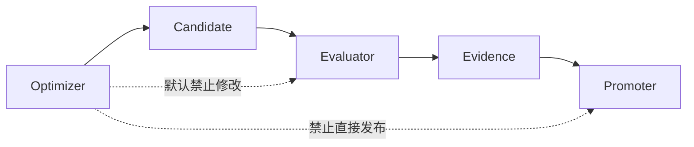

## 2.4 所有可优化对象必须版本化

可优化 Surface：

```text
SYSTEM_PROMPT
TOOL_DESCRIPTION
SKILL
CONFIG
RULE
CODE
```

任何 Candidate 最终必须对应一个不可变的 `AgentSnapshot`。

## 2.5 Optimization / Regression / Holdout 必须隔离

```text
Optimization Set
= Optimizer 可以看到

Regression Set
= 历史正确行为 / 已修复问题

Holdout Set
= Optimizer 不可见

Red Team
= 安全 / 边界场景
```

---

# 3. 系统分层

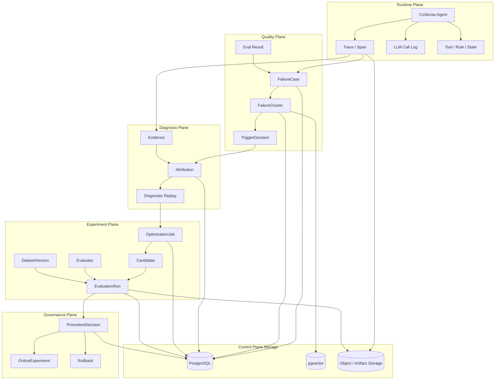

---

# 4. 模块总览

| 模块 | 职责 | Source of Truth |
|---|---|---|
| AgentSnapshot | 标识一个不可变 Agent 版本 | PostgreSQL |
| ExecutionRun | 标识一次顶层执行 | PostgreSQL |
| Trace / Span | 记录运行过程 | 现有 Trace Store |
| Eval Result | 保存全部评测结果 | 现有 Eval Hub |
| FailureCase | 将 FAIL / UNKNOWN 转为问题入口 | PostgreSQL |
| FailureCluster | 聚合 recurring failure pattern | PostgreSQL + pgvector |
| TriggerDecision | 判断是否 INVESTIGATE / OPTIMIZE | PostgreSQL |
| Attribution | 根因假设与证据 | PostgreSQL |
| Diagnostic Replay | 用 intervention 验证 attribution | Replay Harness |
| OptimizationJob | 定义一次受控优化 | PostgreSQL |
| Candidate | Optimizer 生成的候选版本 | PostgreSQL + Artifact Store |
| EvaluatorRegistry | 版本化 evaluator | PostgreSQL |
| DatasetRegistry | 版本化 Optimization / Regression / Holdout | PostgreSQL + Artifact Store |
| EvaluationRun | Candidate vs Baseline 实验 | PostgreSQL |
| PromotionDecision | 是否进入下一 Baseline | PostgreSQL |
| OnlineExperiment | Shadow / Canary / A-B | PostgreSQL |
| Workflow | 驱动长生命周期任务 | P0 DB State / P2 Temporal |
| Observability | Improvement 系统自身健康 | Metrics + Logs |

---

# 5. P0 Identity Layer

P0 的目标：

> 给任意 FailureCase，能够唯一定位一次执行、一个 Trace、一个 Snapshot 和一个 Evaluator。

---

# 6. AgentSnapshot

## 6.1 职责

AgentSnapshot 表示：

> 一套足以影响 Agent 行为的不可变配置集合。

不是一次执行，也不是一个 Git commit。

## 6.2 Snapshot 内容

```text
Code
Prompt
Model Route
Tool Schema
Policy
Feature Flag
Runtime Config
```

## 6.3 数据模型

```sql
CREATE TABLE agent_snapshot (
    snapshot_id UUID PRIMARY KEY,

    snapshot_hash VARCHAR(128) UNIQUE NOT NULL,

    git_sha VARCHAR(128),
    git_dirty BOOLEAN,

    prompt_bundle_version VARCHAR(128),
    prompt_bundle_hash VARCHAR(128),

    model_route_version VARCHAR(128),
    model_route_hash VARCHAR(128),

    tool_schema_version VARCHAR(128),
    tool_schema_hash VARCHAR(128),

    policy_version VARCHAR(128),
    policy_hash VARCHAR(128),

    feature_flag_version VARCHAR(128),
    feature_flag_hash VARCHAR(128),

    runtime_config_version VARCHAR(128),
    runtime_config_hash VARCHAR(128),

    components JSONB NOT NULL,

    artifact_ref TEXT,

    completeness VARCHAR(32) NOT NULL DEFAULT 'COMPLETE',

    schema_version INT NOT NULL DEFAULT 1,

    created_at TIMESTAMPTZ NOT NULL,
    created_by VARCHAR(128)
);
```

## 6.4 components JSON 格式

```json
{
  "code": {
    "git_sha": "abc123",
    "dirty": false
  },
  "prompt": {
    "bundle": "dialogue-v18",
    "hash": "sha256:..."
  },
  "model_route": {
    "version": "route-v7",
    "hash": "sha256:..."
  },
  "tools": {
    "version": "tools-v12",
    "hash": "sha256:..."
  },
  "policy": {
    "version": "policy-v9",
    "hash": "sha256:..."
  },
  "feature_flags": {
    "version": "flags-20260916",
    "hash": "sha256:..."
  }
}
```

## 6.5 Snapshot Hash

```text
canonicalize(
    git_sha,
    git_dirty,
    prompt_hash,
    model_route_hash,
    tool_schema_hash,
    policy_hash,
    feature_flag_hash,
    runtime_config_hash
)
↓
SHA-256
↓
snapshot_hash
```

语义：

```text
相同行为配置
→ 相同 Snapshot

任何影响行为的配置变化
→ 新 Snapshot
```

## 6.6 生命周期

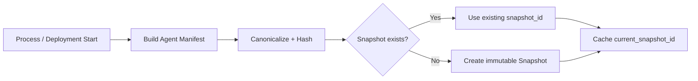

运行时配置发生变化：

```text
Config Watcher
→ Build New Manifest
→ resolve()
→ new snapshot_id
→ atomic switch
```

---

# 7. ExecutionRun

## 7.1 职责

ExecutionRun 是整个系统唯一的：

> Execution Correlation Identity

一次顶层执行就是一个 Run，例如：

```text
Production dialogue turn
Quality eval case
Replay attempt
Experiment candidate run
```

一次 LLM call 不是 Run。

## 7.2 数据模型

```sql
CREATE TABLE execution_run (
    run_id UUID PRIMARY KEY,

    snapshot_id UUID NOT NULL
        REFERENCES agent_snapshot(snapshot_id),

    trace_id VARCHAR(256),

    parent_run_id UUID,
    root_run_id UUID NOT NULL,

    mode VARCHAR(32) NOT NULL,

    run_type VARCHAR(128),

    source_ref TEXT,

    case_id VARCHAR(256),
    repeat_index INT,

    input_ref TEXT,
    input_hash VARCHAR(128),

    state_snapshot_ref TEXT,
    state_hash VARCHAR(128),

    status VARCHAR(32) NOT NULL,

    actual_model_summary JSONB,
    cost_summary JSONB,
    latency_summary JSONB,

    experiment_assignments JSONB,

    started_at TIMESTAMPTZ NOT NULL,
    ended_at TIMESTAMPTZ,

    schema_version INT NOT NULL DEFAULT 1,

    metadata JSONB
);
```

## 7.3 mode

```text
PROD
EVAL
REPLAY
EXPERIMENT
```

## 7.4 status

```text
RUNNING
SUCCEEDED
FAILED
CANCELLED
UNKNOWN
```

## 7.5 ExecutionContext

内部统一透传：

```python
@dataclass
class ExecutionContext:
    run_id: UUID
    snapshot_id: UUID
    mode: RunMode

    trace_id: str | None = None

    case_id: str | None = None
    repeat_index: int | None = None

    parent_run_id: UUID | None = None
    root_run_id: UUID | None = None
```

禁止继续到处分别透传：

```text
git_sha
trace_id
case_id
span_id
```

---

# 8. Run 创建逻辑

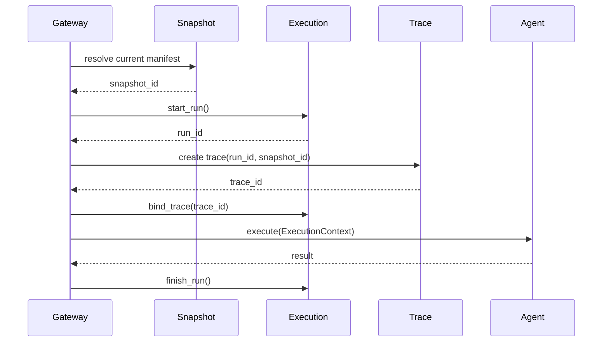

关键原则：

```text
ExecutionRun 先创建
Agent 后执行
```

即使 Agent crash / timeout，Run 仍然存在。

---

# 9. Trace / Span Contract

所有 Trace / Span 至少携带：

```text
cosense.run_id
cosense.snapshot_id
cosense.mode
```

可选：

```text
cosense.case_id
cosense.repeat_index
cosense.parent_run_id
```

## 9.1 OpenTelemetry 对齐

现有 Trace 不重建。

采用：

```text
Existing Trace
+
OTel Semantic Adapter
```

OpenTelemetry 作为 Trace Contract，不作为新的 Trace Storage。

---

# 10. LLM Call Log

现有 LLM Call Log 保留。

补充：

```text
run_id
snapshot_id
trace_id
span_id
```

实际执行数据继续记录：

```text
requested_model
actual_provider
actual_model
fallback_reason
temperature
tokens
cost
cache_hit
retry_count
latency
```

关系：

```text
AgentSnapshot
↓
ExecutionRun
↓
Trace Span
↓
LlmCallLog
```

---

# 11. Eval Result

EvalResult 保存全部评测结果，包括：

```text
PASS
FAIL
UNKNOWN
```

FailureCase 不替代 EvalResult。

## 11.1 推荐字段

```text
eval_result
────────────────────────
eval_result_id
run_id

evaluator_id
evaluator_version

dataset_version_id
case_id

metric_name

observed_value
threshold

verdict

evidence

created_at
```

---

# 12. FailureCase

## 12.1 定义

FailureCase 表示：

> 一个明确质量信号针对某一个 ExecutionRun 做出的 FAIL / UNKNOWN 判断。

一个 Run 可以产生多个 FailureCase。

## 12.2 数据模型

```sql
CREATE TABLE failure_case (
    failure_case_id UUID PRIMARY KEY,

    run_id UUID NOT NULL
        REFERENCES execution_run(run_id),

    snapshot_id UUID NOT NULL
        REFERENCES agent_snapshot(snapshot_id),

    trace_id VARCHAR(256),

    source_type VARCHAR(64) NOT NULL,
    source_id VARCHAR(256),

    evaluator_id VARCHAR(256),
    evaluator_version VARCHAR(128),

    metric_name VARCHAR(256),

    observed_value JSONB,
    threshold_value JSONB,

    verdict VARCHAR(32) NOT NULL,

    taxonomy VARCHAR(256),

    severity VARCHAR(32),
    confidence DOUBLE PRECISION,

    evidence JSONB,
    evidence_span_ids JSONB,

    status VARCHAR(64) NOT NULL,

    dedup_key VARCHAR(256) UNIQUE NOT NULL,

    created_at TIMESTAMPTZ NOT NULL,

    schema_version INT NOT NULL DEFAULT 1,

    metadata JSONB
);
```

## 12.3 source_type

```text
EVAL
ONLINE_SIGNAL
HUMAN_FEEDBACK
BUSINESS_METRIC
SYSTEM_ERROR
```

## 12.4 verdict

FailureCase 只保存：

```text
FAIL
UNKNOWN
```

PASS 留在 EvalResult。

## 12.5 status

```text
NEW
CONFIRMED
FALSE_POSITIVE
INSUFFICIENT_EVIDENCE
RESOLVED
```

## 12.6 Dedup

```text
dedup_key =
hash(
  source_type,
  source_id,
  run_id,
  evaluator_id,
  evaluator_version,
  metric_name
)
```

Failure ingestion 必须天然幂等。

---

# 13. FailureCase 调用链

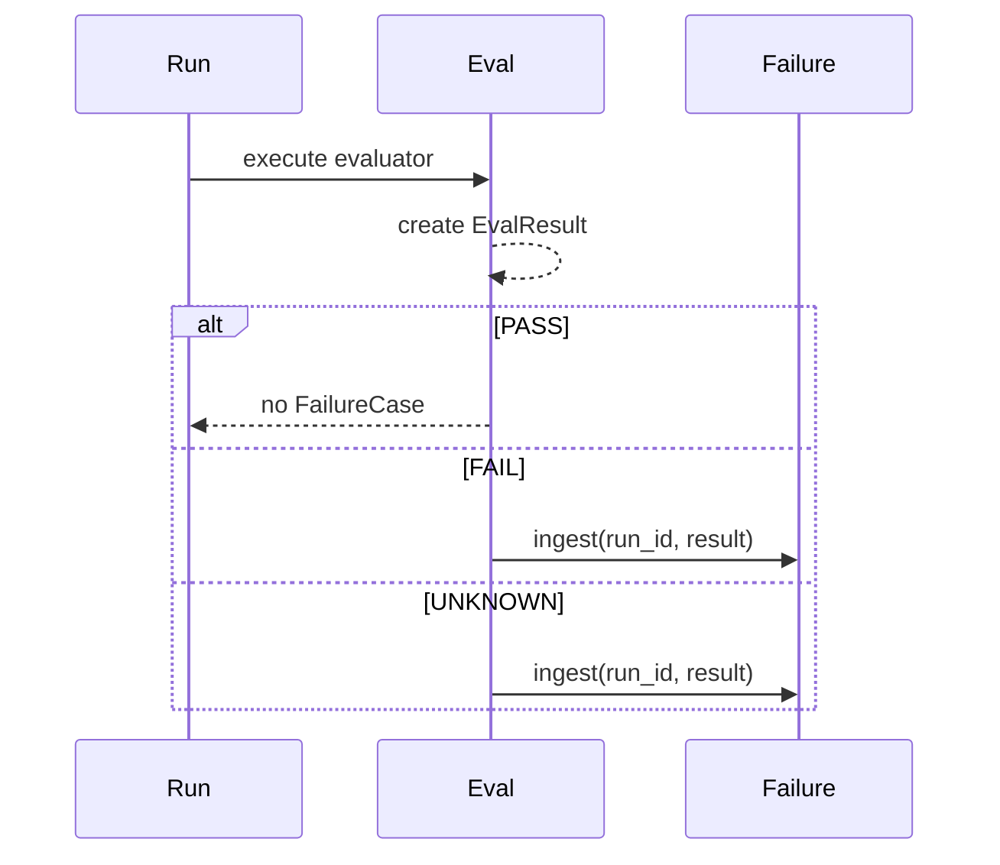

---

# 14. Failure Intelligence

Failure Intelligence 负责：

```text
FailureCase
→ taxonomy
→ representation
→ embedding
→ clustering
→ recurring problem
```

---

# 15. Failure Taxonomy

第一版推荐 Failure Symptom 和 Fault Domain 分离。

## Failure Symptom

描述表现是什么：

```text
WRONG_TOOL
UNWANTED_ACTION
MISSING_ACTION
INCORRECT_RESPONSE
IRRELEVANT_RESPONSE
MEMORY_ERROR
CONTEXT_ERROR
TIMEOUT
HIGH_LATENCY
HIGH_COST
SYSTEM_ERROR
UNKNOWN_FAILURE
```

## Fault Domain

描述可能是谁导致：

```text
MODEL_PROMPT
CONTEXT
MEMORY
TOOL_DESCRIPTION
TOOL_EXECUTION
RULE_POLICY
STATE
ROUTING
INFRA
EVALUATOR
UNKNOWN
```

FailureCase 初期只需要 Failure Symptom。

Fault Domain 属于 Attribution。

---

# 16. Failure Representation

进入聚类前，将一个 FailureCase 转成稳定文本：

```text
[SYMPTOM]
wrong_tool

[EXPECTED]
refund request should call refund_tool

[ACTUAL]
cancel_order_tool called

[USER_INTENT]
cancel and refund order

[KEY_TRACE]
intent=refund
model_decision=cancel_order
tool=cancel_order

[SNAPSHOT]
tool_schema=v12
policy=v9
```

禁止直接把整条 Trace 全量 embedding。

---

# 17. Failure Embedding

数据：

```text
failure_case.embedding
```

存储：

```text
pgvector
```

Embedding Model 暂不锁死，必须使用真实 FailureCase 做 benchmark 后决定。

---

# 18. Failure Clustering

推荐：

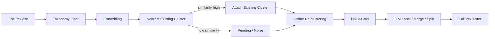

---

# 19. FailureCluster 数据模型

```sql
CREATE TABLE failure_cluster (
    cluster_id UUID PRIMARY KEY,

    cluster_version INT NOT NULL,

    taxonomy VARCHAR(256),

    title TEXT NOT NULL,
    description TEXT,

    case_count INT NOT NULL,

    prevalence DOUBLE PRECISION,
    severity_score DOUBLE PRECISION,
    impact_score DOUBLE PRECISION,

    representative_case_ids JSONB,

    centroid VECTOR,

    first_seen_at TIMESTAMPTZ,
    last_seen_at TIMESTAMPTZ,

    status VARCHAR(64),

    created_at TIMESTAMPTZ,
    updated_at TIMESTAMPTZ,

    metadata JSONB
);
```

成员：

```sql
CREATE TABLE failure_cluster_member (
    cluster_id UUID NOT NULL,
    failure_case_id UUID NOT NULL,

    membership_score DOUBLE PRECISION,

    PRIMARY KEY(cluster_id, failure_case_id)
);
```

---

# 20. Cluster 生命周期

```text
NEW
ACTIVE
WATCHING
INVESTIGATING
RESOLVED
ARCHIVED
SPLIT
MERGED
```

Cluster split / merge 时旧 Cluster 不删除，而记录：

```text
superseded_by
merged_into
split_into
```

保证历史可审计。

---

# 21. Trigger Engine

Trigger Engine 负责：

> 判断一个 Cluster 是否值得进入调查 / 优化。

---

# 22. TriggerPolicy

```text
trigger_policy
────────────────────────
policy_id
version

target_taxonomy

min_case_count
min_prevalence
min_severity
min_confidence

cooldown

budget_policy_id

enabled
```

---

# 23. TriggerDecision

```text
trigger_decision
────────────────────────
decision_id

cluster_id

policy_id
policy_version

decision:
  IGNORE
  WATCH
  INVESTIGATE
  OPTIMIZE

reason

metrics_snapshot
budget_snapshot

created_at
```

---

# 24. Trigger 逻辑

推荐：

```text
priority_score
=
prevalence
× severity
× business_impact
× signal_confidence
```

硬条件：

```text
reproducible / evidence_available
budget_available
not_in_cooldown
```

P0.5 第一阶段：

```text
系统可以自动 INVESTIGATE
人工批准 OPTIMIZE
```

---

# 25. Attribution

Attribution 负责：

> 形成“为什么发生”的可验证假设。

---

# 26. Attribution 数据模型

```text
attribution
────────────────────────
attribution_id

cluster_id

fault_domain

target_type
target_ref

hypothesis

confidence

status:
  PROPOSED
  SUPPORTED
  VALIDATED
  REJECTED
  UNKNOWN

created_by
model_version

created_at
updated_at
```

---

# 27. AttributionEvidence

```text
attribution_evidence
────────────────────────
evidence_id

attribution_id

evidence_type:
  TRACE
  SPAN
  STATE
  CONFIG
  EVAL_RESULT
  LOG
  CODE

evidence_ref

relation:
  SUPPORT
  REFUTE

explanation
```

---

# 28. Attribution 逻辑

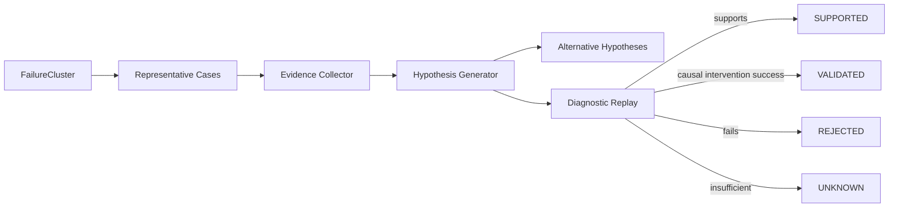

---

# 29. Evidence Collector

Evidence Package 最小组成：

```json
{
  "cluster": {
    "cluster_id": "...",
    "taxonomy": "WRONG_TOOL"
  },
  "cases": [
    {
      "failure_case_id": "...",
      "run_id": "...",
      "trace_id": "...",
      "evidence_spans": ["..."]
    }
  ],
  "snapshot": {
    "snapshot_id": "...",
    "prompt_version": "...",
    "tool_schema_version": "...",
    "policy_version": "..."
  },
  "state": {
    "available": true,
    "ref": "..."
  },
  "known_missing_evidence": []
}
```

---

# 30. Diagnostic Replay

Diagnostic Replay 不等于 Candidate Evaluation。

它的目标是：

> 验证 Attribution Hypothesis。

## 30.1 Replay Mode

```text
DETERMINISTIC
LLM_RERUN
ENVIRONMENT_REPLAY
```

## 30.2 Deterministic Replay

固定：

```text
input
state
LLM output
```

只修改：

```text
rule
gate
state transition
tool logic
```

## 30.3 LLM Rerun

固定：

```text
input
recoverable state
```

重新运行：

```text
new prompt
new model route
new skill
```

## 30.4 Replay Report

必须包含：

```text
replay_mode
baseline_run_id
candidate_snapshot_id

missing_state
mocked_dependencies
uncovered_paths

actual_model
actual_config

evaluator_version

result
```

---

# 31. Diagnostic Intervention

例如：

```text
Hypothesis:
ActionGate regexp priority causes refund action
```

实验：

```text
固定：
user input
state
intent result
model decision

只替换：
ActionGate rule
```

如果 failure disappears，则：

```text
Attribution.status = VALIDATED
```

---

# 32. OptimizationJob

OptimizationJob 表示：

> 针对一个已经足够可信的问题，进行一次受控搜索。

---

# 33. OptimizationJob 数据模型

```text
optimization_job
────────────────────────
job_id

cluster_id
attribution_id

baseline_snapshot_id

surface:
  SYSTEM_PROMPT
  TOOL_DESCRIPTION
  SKILL
  CONFIG
  RULE
  CODE

target_ref

algorithm:
  HUMAN
  LLM_REWRITE
  GEPA
  CODING_AGENT
  SEARCH

objective_evaluator_id

max_candidates
max_llm_calls
max_tokens
max_cost
max_rounds
max_wall_time

status

created_at
started_at
ended_at
```

---

# 34. Optimization Surface 权限

| Surface | 自动生成 | 自动评测 | 自动 Merge |
|---|---:|---:|---:|
| Tool Description | Yes | Yes | No |
| System Prompt | Yes | Yes | No |
| Skill | Yes | Yes | No |
| Config | Limited | Yes | No |
| Rule | Limited | Yes | No |
| Code | Yes via Coding Agent | Yes | No |
| Evaluator | No | Separate Governance | No |

---

# 35. Optimizer SPI

统一接口：

```python
class Optimizer:

    def optimize(
        self,
        *,
        baseline_snapshot,
        target,
        evidence,
        optimization_set,
        validation_set,
        budget,
    ) -> list[Candidate]:
        ...
```

---

# 36. Optimizer 实现

第一阶段：

```text
HumanOptimizer
LLMRewriteOptimizer
GEPAOptimizer
CodingAgentOptimizer
```

## 36.1 GEPA 使用范围

优先：

```text
SYSTEM_PROMPT
TOOL_DESCRIPTION
SKILL
```

输入：

```text
trace
failure evidence
evaluator textual feedback
optimization dataset
validation dataset
```

---

# 37. Candidate

Candidate 表示：

> 一个可独立评测、可追踪 lineage 的候选修改。

## 37.1 数据模型

```text
candidate
────────────────────────
candidate_id

job_id

parent_candidate_id

snapshot_id

change_type
change_ref
diff_ref

rationale

optimizer_name
optimizer_version

iteration

created_at
```

---

# 38. Candidate Lineage

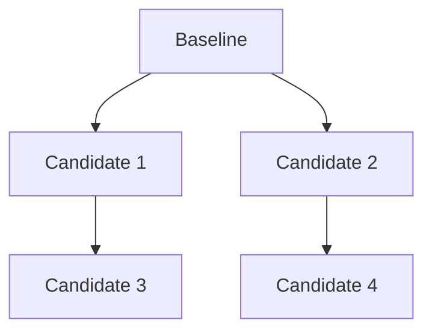

Candidate 永远不能只是一段 diff，必须能 resolve：

```text
Candidate → AgentSnapshot
```

---

# 39. Evaluator Registry

Evaluator 必须版本化。

---

# 40. Evaluator 数据模型

```text
evaluator
────────────────────────
evaluator_id
version

name
metric_name

type:
  DETERMINISTIC
  LLM_JUDGE
  HYBRID
  BUSINESS_METRIC

rubric_ref
rubric_hash

judge_model

code_version

score_schema

created_at
```

---

# 41. Evaluator 规则

Judge Model 改变：

```text
→ 新 evaluator version
```

Rubric 改变：

```text
→ 新 evaluator version
```

Code 改变：

```text
→ 新 evaluator version
```

历史 EvalResult 不覆盖。

---

# 42. Dataset Registry

```text
dataset_version
────────────────────────
dataset_version_id

dataset_name

partition:
  OPTIMIZATION
  REGRESSION
  HOLDOUT
  RED_TEAM

content_hash

case_count

artifact_ref

created_at
```

---

# 43. Dataset 隔离

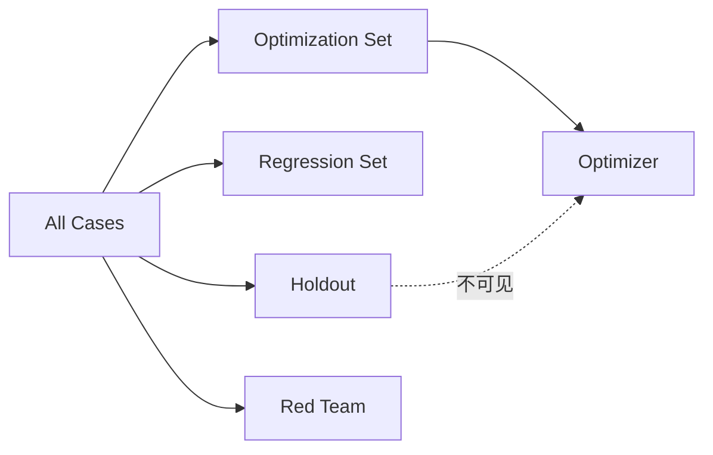

---

# 44. EvaluationRun

EvaluationRun 表示：

> 一个 Candidate 与一个 Baseline 在明确数据集 / Evaluator 下的实验。

---

# 45. EvaluationRun 数据模型

```text
evaluation_run
────────────────────────
evaluation_run_id

candidate_snapshot_id
baseline_snapshot_id

dataset_version_id

evaluator_id
evaluator_version

replay_mode

repeat_count

status

started_at
ended_at

summary
```

---

# 46. EvaluationResult

```text
evaluation_result
────────────────────────
evaluation_run_id
case_id

baseline_score
candidate_score
delta

pass
regression

baseline_run_id
candidate_run_id

trace_id
```

---

# 47. Evaluation Summary

必须至少包括：

```text
primary_delta
regression_count
regression_rate

holdout_delta

latency_delta
token_delta
cost_delta

confidence_interval

not_covered_count
unknown_count
```

---

# 48. Evaluation Pipeline

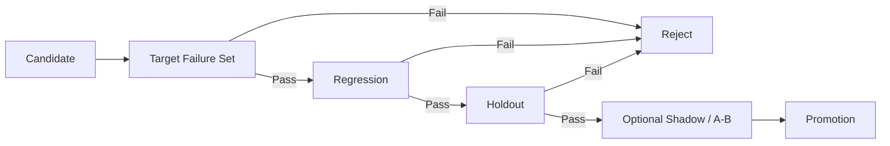

从左到右成本逐渐增加。

---

# 49. Regression Corpus

任何被验证并 Promotion 的问题都必须沉淀：

```text
representative cases
boundary cases
counterexamples
validated attribution
regression test
```

形成：

```text
Problem
→ Fix
→ Regression Corpus
→ Future Eval
```

这是系统真正的“学习”。

---

# 50. PromotionDecision

Promotion 表示：

> 为什么 Candidate 有资格成为新的 Baseline。

---

# 51. Promotion 数据模型

```text
promotion
────────────────────────
promotion_id

candidate_snapshot_id
baseline_snapshot_id

evaluation_run_ids[]

decision:
  REJECTED
  APPROVED
  SHADOW
  CANARY
  AB_TEST
  PROMOTED
  ROLLED_BACK

gate_result

approved_by

approval_type:
  HUMAN
  POLICY

reason

rollback_snapshot_id

created_at
```

---

# 52. Promotion Gate

第一阶段：

```text
Target Failure Improved
AND Regression Pass
AND Holdout Pass
AND Cost Within Budget
AND Latency Within Budget
AND Human Approved
```

才允许：

```text
PROMOTED
```

---

# 53. OnlineExperiment

未来 P3：

```text
online_experiment
────────────────────────
experiment_id

control_snapshot_id
treatment_snapshot_id

traffic_split

evaluator_bundle_version

started_at
ended_at

winner_snapshot_id
significance
```

---

# 54. Online Flow

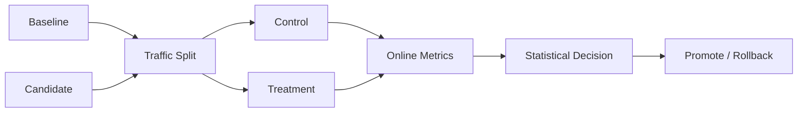

---

# 55. Workflow Engine

## P0 / P0.5

采用：

```text
PostgreSQL State Machine
+
现有 Background Task / Queue
```

## P2+

满足以下条件后引入 Temporal：

```text
Long-running workflow
Human approval waiting
Parallel candidate eval
Retry / Timeout
Cancellation
Resume after days
```

原则：

```text
Temporal / DB
= Business Workflow

LangGraph / Agent framework
= Optimizer internal reasoning
```

两者不混。

---

# 56. 状态机

## 56.1 ExecutionRun

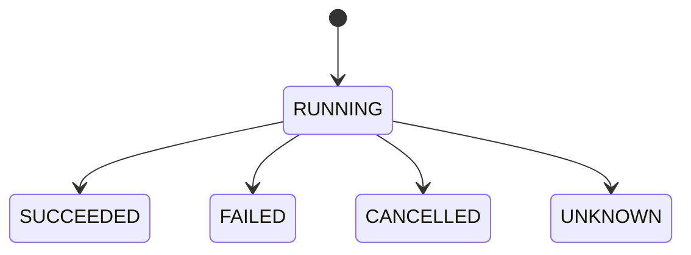

## 56.2 FailureCase

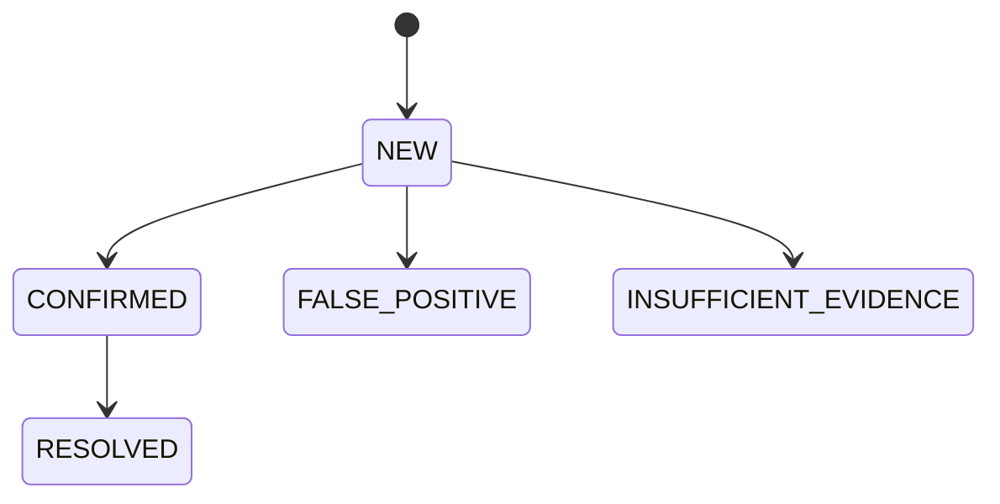

## 56.3 Attribution

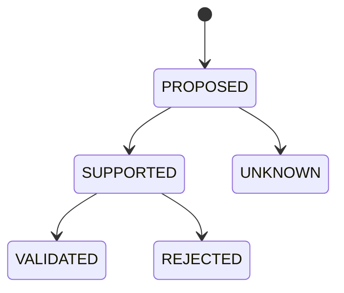

## 56.4 OptimizationJob

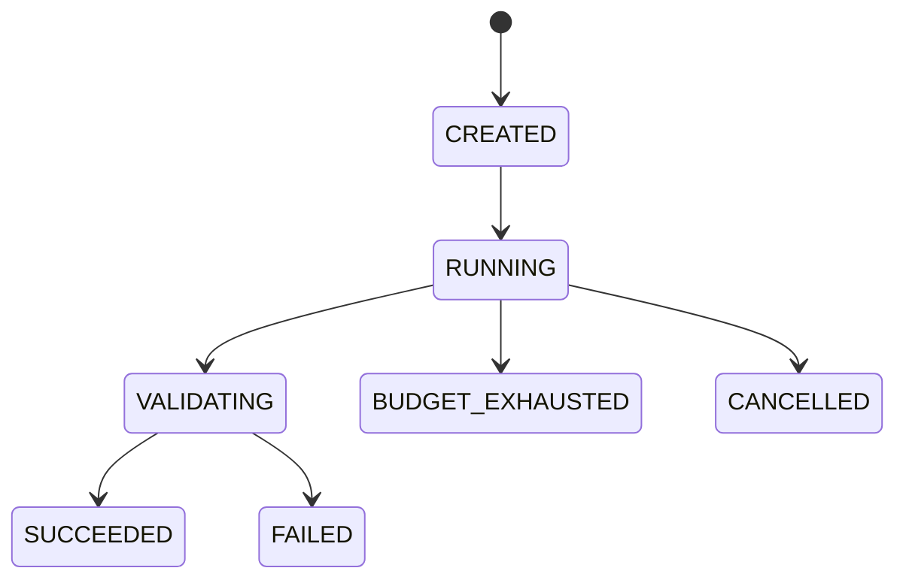

---

# 57. Storage 设计

## PostgreSQL

保存：

```text
metadata
identity
state
relationships
decision records
version references
```

## JSONB

用于：

```text
components
summary
evidence metadata
model call summary
cost summary
```

不能用 JSONB 替代核心关系。

## Object / Artifact Storage

保存：

```text
large trace archive
state snapshot
conversation artifact
replay artifact
evaluation report
candidate patch
prompt artifact
```

主表只保存：

```text
artifact_ref
hash
```

## pgvector

只用于：

```text
Failure semantic similarity
Cluster retrieval
Representative case search
```

不作为业务 Source of Truth。

---

# 58. API / Service Contracts

## 58.1 SnapshotService

```python
class SnapshotService:

    def resolve(
        self,
        manifest: AgentManifest,
    ) -> AgentSnapshot:
        ...

    def get(
        self,
        snapshot_id: UUID,
    ) -> AgentSnapshot:
        ...
```

## 58.2 ExecutionService

```python
class ExecutionService:

    def start_run(
        self,
        *,
        mode: RunMode,
        snapshot_id: UUID,
        run_type: str,
        parent_run_id: UUID | None = None,
        case_id: str | None = None,
        repeat_index: int | None = None,
        input_ref: str | None = None,
    ) -> ExecutionRun:
        ...

    def bind_trace(
        self,
        run_id: UUID,
        trace_id: str,
    ) -> None:
        ...

    def finish_run(
        self,
        run_id: UUID,
        *,
        status: RunStatus,
        summaries: RunSummary,
    ) -> None:
        ...
```

## 58.3 FailureService

```python
class FailureService:

    def ingest(
        self,
        *,
        run_id: UUID,
        source: FailureSource,
        evaluator: EvaluatorRef | None,
        metric: MetricResult,
        verdict: Verdict,
        evidence: Evidence,
    ) -> FailureCase | None:
        ...
```

## 58.4 ClusterService

```python
class ClusterService:

    def attach(
        self,
        failure_case_id: UUID,
    ) -> ClusterAssignment:
        ...

    def recluster(
        self,
        *,
        taxonomy: str,
        time_range: TimeRange,
    ) -> list[FailureCluster]:
        ...
```

## 58.5 AttributionService

```python
class AttributionService:

    def investigate(
        self,
        cluster_id: UUID,
    ) -> list[Attribution]:
        ...

    def validate(
        self,
        attribution_id: UUID,
        replay_plan: ReplayPlan,
    ) -> AttributionResult:
        ...
```

## 58.6 EvaluationService

```python
class EvaluationService:

    def compare(
        self,
        *,
        baseline_snapshot_id: UUID,
        candidate_snapshot_id: UUID,
        dataset_version_id: UUID,
        evaluator_bundle: list[EvaluatorRef],
    ) -> EvaluationRun:
        ...
```

## 58.7 PromotionService

```python
class PromotionService:

    def decide(
        self,
        *,
        candidate_snapshot_id: UUID,
        baseline_snapshot_id: UUID,
        evaluation_run_ids: list[UUID],
    ) -> PromotionDecision:
        ...
```

---

# 59. 查询 API

P0 最重要：

```http
GET /internal/failures/{failure_case_id}
```

返回：

```json
{
  "failure": {},
  "execution": {},
  "snapshot": {},
  "trace": {},
  "evaluator": {}
}
```

---

# 60. End-to-End：Production Failure

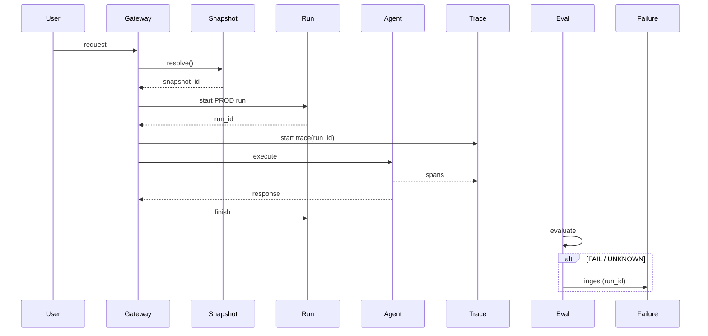

---

# 61. End-to-End：Failure → Improvement

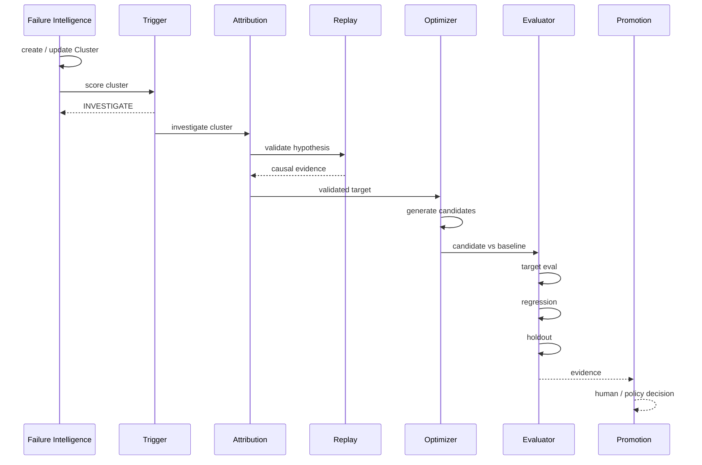

---

# 62. 错误处理

## Trace 创建失败

```text
ExecutionRun 仍然保留
trace_id = NULL
```

Failure：

```text
INSUFFICIENT_EVIDENCE
```

不能删除 Run。

## State 无法恢复

Replay：

```text
missing_state = [...]
```

不能假装完整回放。

## LLM Judge 失败

Eval：

```text
verdict = UNKNOWN
```

不能当 PASS。

## Optimizer 超预算

```text
OptimizationJob.status =
BUDGET_EXHAUSTED
```

禁止无限重试。

---

# 63. Cost / Budget

每个 OptimizationJob 必须包含：

```text
max_candidates
max_llm_calls
max_tokens
max_cost
max_rounds
max_wall_time
```

执行顺序：

```text
cheap deterministic check
→ targeted replay
→ small eval
→ regression
→ holdout
→ online
```

任何阶段失败：

```text
early stop
```

---

# 64. Privacy / Security

## AgentSnapshot

禁止：

```text
用户 PII
用户 conversation
```

## ExecutionRun

默认只存：

```text
input_ref
input_hash
state_snapshot_ref
state_hash
```

## FailureCase

只保存：

```text
最小 Evidence Reference
```

## Optimizer

默认禁止访问：

```text
Holdout
Production Secret
Unmasked PII
```

Coding Agent：

```text
repo / directory / file allowlist
sandbox
no production credential
PR only
```

---

# 65. Observability

平台自身必须监控：

```text
run_creation_rate
snapshot_resolution_rate
trace_binding_rate
failure_run_link_rate

orphan_trace_count
orphan_failure_count

partial_snapshot_rate

cluster_assignment_rate
cluster_noise_rate

attribution_validation_rate

optimization_success_rate
optimization_cost

regression_rate

promotion_success_rate
post_promotion_rollback_rate
```

---

# 66. Migration

采用：

```text
Schema
→ Shadow Write
→ Dual Write
→ Dual Read
→ Primary Read
→ Cleanup
```

不是 Big Bang。

---

# 67. Migration Step 0

新增：

```text
agent_snapshot
execution_run
failure_case
```

现有行为不改。

字段先允许 Nullable。

---

# 68. Migration Step 1

开始 Shadow Write：

```text
Snapshot
ExecutionRun
```

现有读取继续走旧逻辑。

---

# 69. Migration Step 2

优先改：

```text
Quality Eval
```

每：

```text
case × repeat
```

生成唯一：

```text
run_id
```

彻底删除“通过时间窗口猜 Trace”这条路径。

---

# 70. Migration Step 3

Eval Failure：

```text
旧 evolution_signal
+
新 FailureCase
```

双写。

比对稳定后：

```text
FailureCase
```

成为 Source of Truth。

---

# 71. Migration Step 4

接入顺序：

```text
Quality Eval
→ Replay
→ Production
```

不建议三个同时切。

---

# 72. Legacy 数据

能确定：

```text
→ Backfill
```

不能确定：

```text
→ UNKNOWN
```

禁止猜。

历史只有 git_sha：

```text
AgentSnapshot.completeness = PARTIAL
```

---

# 73. P0 DoD

- [ ] 每个 `case × repeat` 有唯一 `run_id`
- [ ] 每个新 Run 有 immutable `snapshot_id`
- [ ] Trace 可直接按 `run_id` 查询
- [ ] LlmCallLog 可直接按 `run_id` 查询
- [ ] Eval Failure 不再依赖时间窗口关联 Trace
- [ ] FailureCase 能返回 Run + Snapshot + Trace + Evaluator
- [ ] Trace / State 缺失明确标记 UNKNOWN
- [ ] Eval / Replay / Production 共用 Execution Identity

---

# 74. P0.5 DoD

- [ ] Failure taxonomy 可稳定分类
- [ ] Failure Representation 固定格式
- [ ] FailureCase 可增量匹配 Cluster
- [ ] 离线 HDBSCAN 可重新聚类
- [ ] Cluster 可 merge / split 且保留历史
- [ ] Trigger 可输出 WATCH / INVESTIGATE / OPTIMIZE

---

# 75. P0.75 DoD

- [ ] Attribution 有结构化 Hypothesis
- [ ] Attribution Evidence 可追踪
- [ ] Alternative Hypothesis 可表达
- [ ] Diagnostic Replay 可做 intervention
- [ ] 至少一种 fault domain 可被 VALIDATED

---

# 76. P1 DoD

- [ ] Replay Harness 通用化
- [ ] Evaluator 版本化
- [ ] Dataset 版本化
- [ ] Optimization / Regression / Holdout 隔离
- [ ] Candidate vs Baseline 自动比较
- [ ] 输出 Target / Regression / Holdout / Cost / Latency

---

# 77. P2 DoD

- [ ] Optimizer SPI
- [ ] LLM Rewrite Optimizer
- [ ] GEPA Optimizer
- [ ] Coding Agent Optimizer
- [ ] Candidate lineage
- [ ] Budget contract
- [ ] Auto PR
- [ ] Human Merge

---

# 78. P3 DoD

- [ ] Shadow
- [ ] Canary
- [ ] A/B
- [ ] Statistical gate
- [ ] Policy Promotion
- [ ] Automatic rollback boundary

---

# 79. 技术选型

| 领域 | 选型 |
|---|---|
| Control Plane | PostgreSQL |
| Semantic Search | pgvector |
| Artifact | 现有 Archive / Object Storage |
| Telemetry Contract | OpenTelemetry GenAI |
| Observability UI | Existing Viewer + optional Phoenix |
| Failure Clustering | Taxonomy + Embedding + HDBSCAN + LLM Label |
| Workflow P0 | Postgres State Machine |
| Workflow P2+ | Temporal |
| Attribution | Custom Evidence Engine + Diagnostic Replay |
| Evaluation | Existing Eval Hub + Registries |
| Optimizer | Custom SPI |
| First Advanced Optimizer | GEPA |
| Code Optimizer | Coding Agent |
| Promotion | Git PR + CI + Human Gate |

---

# 80. 不采用 / 暂缓

当前不优先：

```text
RL Weight Evolution
Agent Lightning Training Loop
Recursive Self-Modifying Agent
Auto Merge
Auto Deploy
Independent Vector Database
New Trace Backend
New Release System
```

---

# 81. 最终架构核心对象

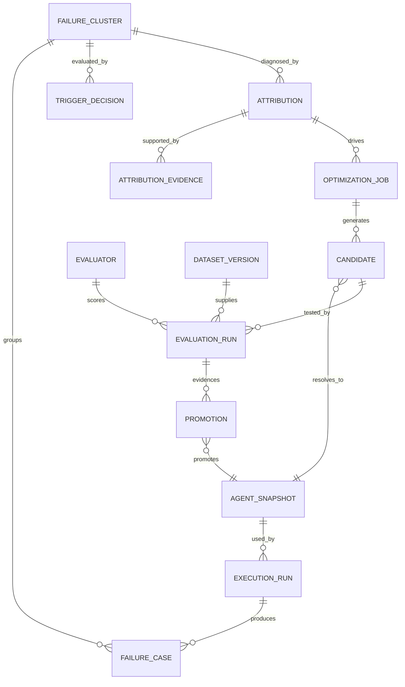

---

# 82. 最终调用链

```text
User / Eval Input
      ↓
AgentSnapshot
      ↓
ExecutionRun
      ↓
Trace / Span / LLM Log
      ↓
EvalResult
      ↓
FailureCase
      ↓
FailureCluster
      ↓
TriggerDecision
      ↓
Attribution Hypothesis
      ↓
Diagnostic Replay / Intervention
      ↓
Validated Attribution
      ↓
OptimizationJob
      ↓
Candidates
      ↓
EvaluationRun
      ↓
Target Eval
      ↓
Regression
      ↓
Holdout
      ↓
PromotionDecision
      ↓
New Baseline Snapshot
      ↓
Production
```

---

# 83. 架构成功标准

系统成功不以：

```text
自动修改次数
```

衡量。

最终核心指标：

```text
Failure Discovery Coverage

Failure → Cluster Time

Cluster → Attribution Time

Attribution Validation Accuracy

Problem MTTR

Optimization Success Rate

Regression Rate

Post-Promotion Rollback Rate

Cost per Successful Improvement
```

最终业务目标：

> 在可控成本和风险下，更快发现真实系统性问题，并以可验证证据推动没有明显回归的改进进入生产。

---

# 84. 一句话定义

> **CoSense Continuous Improvement Platform 是一个以 Execution Identity 为底座，以 Failure Intelligence 为问题入口，以 Causal Attribution 为诊断机制，以 Experimentation 为真相来源，以可插拔 Optimizer 为搜索能力，以 Evidence-Based Promotion 为安全边界的持续改进系统。**

---

# 85. Change Log

## v1.0 — 2026-09-16

首次形成统一 Architecture Source of Truth：

- 确立总体架构
- 确立 P0 Identity Layer
- 定义 AgentSnapshot / ExecutionRun / FailureCase
- 定义 Failure Intelligence
- 定义 Trigger / Attribution / Diagnostic Replay
- 定义 Optimizer / Candidate / Evaluator / Dataset
- 定义 Promotion / Online Experiment
- 确立存储、API、调用链、状态机、迁移策略
- 确立 P0–P3 DoD 与技术选型
